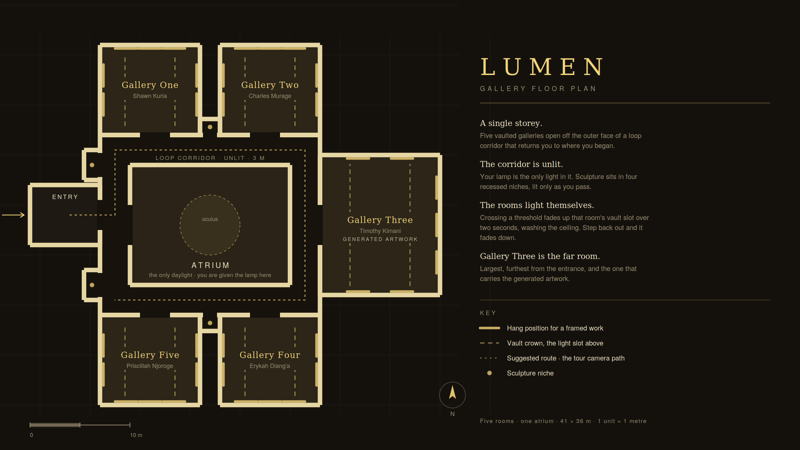

# LUMEN

A walkable virtual gallery in OpenGL.
ICS 3204 Computer Graphics semester project, Strathmore University.

The gallery is unlit. The visitor is the only cause of light in it — directly,
through the lamp they carry, and indirectly, by entering a room and waking the
light slot above it.

| | |
|---|---|
| Five galleries | one per member, off a loop corridor around a central atrium |
| Plan | 41 × 36 m, single storey, 1 world unit = 1 metre |
| Graphics API | OpenGL 3.3 core, GLFW + glad + glm |
| Platform | Windows, Visual Studio 2022 |



---

## Build it (Windows, first time)

You need **Visual Studio 2022** with the *Desktop development with C++* workload,
and **Git**. Everything else is installed by vcpkg.

**1. Get vcpkg** (once per machine, anywhere you like — `C:\dev\vcpkg` is fine):

```bat
git clone https://github.com/microsoft/vcpkg C:\dev\vcpkg
C:\dev\vcpkg\bootstrap-vcpkg.bat
```

**2. Clone this repository:**

```bat
git clone https://github.com/<org>/lumen.git
cd lumen
```

**3. Open it in Visual Studio.**
`File → Open → Folder…` and pick the `lumen` folder. Visual Studio detects
`CMakeLists.txt` and configures automatically.

Point it at vcpkg once — `Project → CMake Settings`, add to *CMake toolchain file*:

```
C:/dev/vcpkg/scripts/buildsystems/vcpkg.cmake
```

Save. The first configure downloads and builds GLFW, glad, glm and the rest.
**This takes ten to twenty minutes the first time** and is silent for long
stretches — it has not hung.

**4. Run.** Select `lumen.exe` as the startup item and press F5.

### Or from the command line

```bat
cmake -B build -S . -DCMAKE_TOOLCHAIN_FILE=C:/dev/vcpkg/scripts/buildsystems/vcpkg.cmake
cmake --build build --config Debug
build\Debug\lumen.exe
```

Run from the repository root so `assets/` and `shaders/` resolve. If you need to
run from elsewhere, pass the asset directory: `lumen.exe path/to/assets/`.

## Controls

| | |
|---|---|
| `W` `A` `S` `D` | walk |
| mouse | look |
| `Shift` | walk faster |
| `Esc` | release the mouse cursor |
| `F1` | print every room's technique notes |

## Run the tests

The algorithms the project is assessed on — Bresenham, midpoint circle,
Cohen–Sutherland, scanline and boundary fill, collision, the reveal state
machine — have no OpenGL in them and are tested on the CPU:

```bat
cmake --build build --config Debug --target lumen_tests
build\Debug\lumen_tests.exe
```

Run this before you push. It takes about a second.

---

## What the project does

| | |
|---|---|
| **Purpose** | A gallery you can walk through when you cannot get to the building, and a demonstration of lighting, shading, texturing and camera control in one space |
| **How to run it** | See above |
| **Technologies** | C++17, OpenGL 3.3 core, GLFW, glad, glm, nlohmann/json, stb_image; CMake + vcpkg |
| **Who contributed** | Shawn Kuria · Charles Murage · Timothy Kimani · Erykah Diang'a · Priscillah Njoroge — see [CONTRIBUTING.md](CONTRIBUTING.md) |

### Graphics techniques implemented

| Technique | Where | Course week |
|---|---|---|
| Polygon extrusion from a 2D plan | `core/Builders.cpp` → `extrudeWalls` | 5 |
| Bresenham line, DDA line | `core/Raster.cpp` → the minimap | 4 |
| Midpoint circle | `core/Raster.cpp` → the minimap | 4 |
| Cohen–Sutherland clipping | `core/Raster.cpp` → minimap viewport | 4 |
| Scanline and boundary fill | `core/Raster.cpp` → room footprints | 5 |
| 3D transformations, model/view/projection | `core/Camera.cpp`, `shaders/lumen.vert` | 8 |
| Blinn-Phong, per fragment | `shaders/lumen.frag` | 12 |
| Gouraud, per vertex (deliberately) | `shaders/lumen.vert`, Gallery Four | 12 |
| Normal mapping from derived relief | `core/Gfx.cpp` → `reliefFrom` | 12 |
| Texture mapping, mipmaps, anisotropic filtering | `core/Gfx.cpp` | 12 |
| Animation — the reveal fade | `core/Lighting.cpp` | 9 |
| Procedural generation | Gallery Three | — |
| AABB collision | `core/Collision.cpp` | — |

The minimap is the important row. The 3D view is rasterised by the GPU; the
minimap is rasterised by us, on the CPU, with the algorithms above. That is why
`core/Raster.cpp` exists and why it must not be replaced with library calls.

---

## Layout

```
assets/        plan.json (generated), works.json, textures
docs/          the floor plan drawing, lighting and artwork notes
shaders/       lumen.vert, lumen.frag  - one shader, a mode enum
src/core/      SHARED. Changes go through a pull request.
src/rooms/     one file per member. Yours is yours alone.
tests/         CPU tests for the algorithms above
tools/         generate-floor-plan.py - the plan is generated, not hand-edited
```

**`assets/plan.json` is generated.** Do not hand-edit it. Edit
`tools/generate-floor-plan.py` and rerun it — the same script produces the
drawing in `docs/` and the data the game loads, so the slide and the build can
never drift apart.

```bash
python tools/generate-floor-plan.py
```

Read [CONTRIBUTING.md](CONTRIBUTING.md) before your first commit, and
[src/core/Room.h](src/core/Room.h) before you touch your room.
